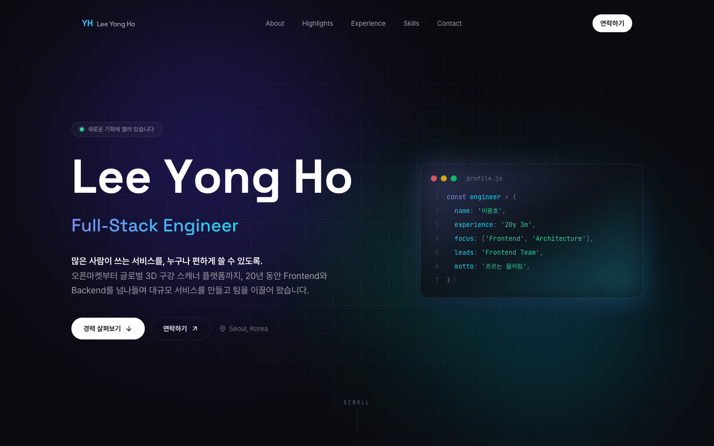
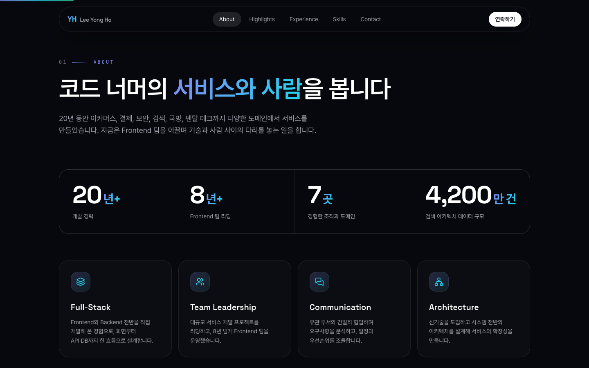
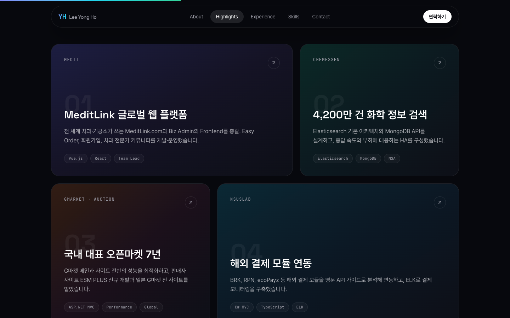
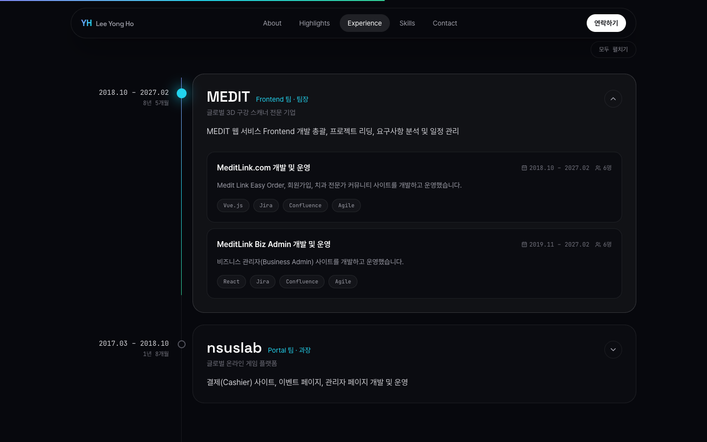
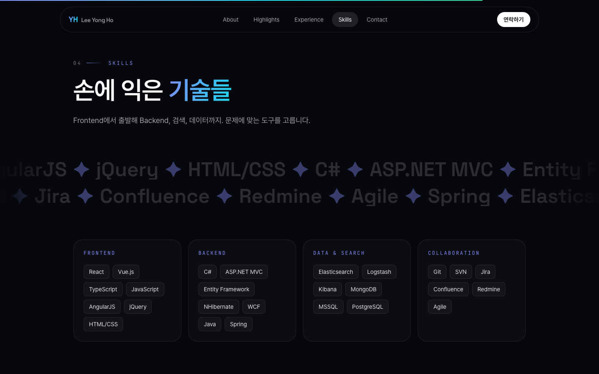
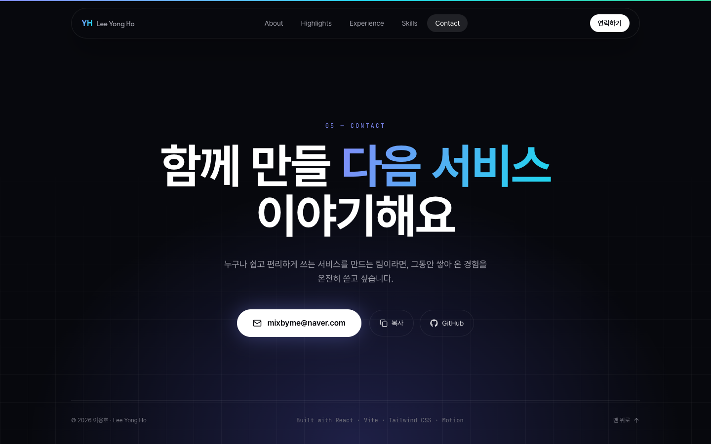
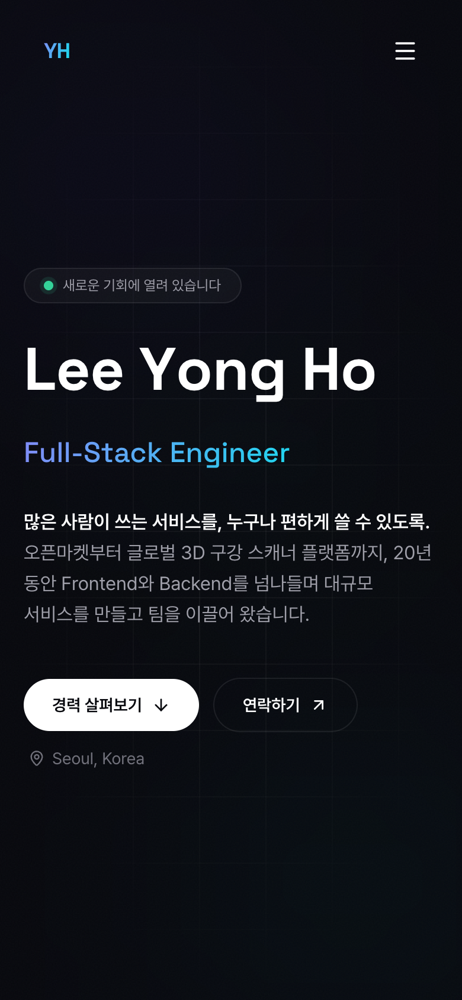
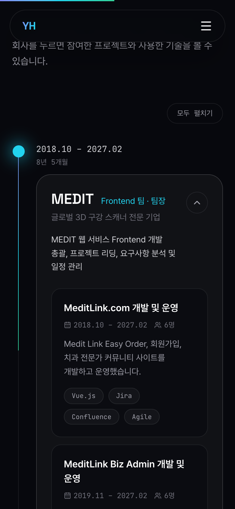

<div align="center">

# 이용호 · Lee Yong Ho

**20년 경력 Frontend Team Leader의 포트폴리오 사이트**

많은 사람이 쓰는 서비스를, 누구나 편하게 쓸 수 있도록.

### 🔗 [mixbyme-portfolio.vercel.app](https://mixbyme-portfolio.vercel.app)




</div>

## 소개

오픈마켓(G마켓·옥션)부터 글로벌 3D 구강 스캐너 플랫폼(MEDIT)까지, 20년 동안 Frontend와 Backend를 넘나들며 대규모 서비스를 만들고 팀을 이끌어 온 경력을 한 페이지에 담았습니다.

- **20년+** 개발 경력, **8년+** Frontend 팀 리딩
- 이커머스, 결제, 보안, 검색, 국방, 덴탈 테크 등 **7개 조직**에서 쌓은 도메인 경험
- **4,200만 건** 규모 화학 정보 검색 아키텍처 설계

## 구성

| 섹션 | 내용 |
|---|---|
| **Hero** | 이름과 직함, 한 줄 소개 |
| **About** | 숫자로 보는 경력, 핵심 역량 4가지, 일하는 방식 |
| **Highlights** | 임팩트가 컸던 대표 프로젝트 4개 |
| **Design System** | 직접 만든 React 컴포넌트 디자인 시스템. 라이트/다크 전환 가능한 컴포넌트 미리보기와 Storybook·GitHub 링크 |
| **Experience** | 회사별 경력 타임라인. 누르면 프로젝트 상세와 사용 기술이 펼쳐짐 |
| **Skills** | 기술 스택, 학력, 자격증, 어학, 교육 이력 |
| **Contact** | 이메일, GitHub |

## 스크린샷

<table>
  <tr>
    <td width="50%"><p align="center"><b>About</b> · 경력 지표와 핵심 역량</p></td>
    <td width="50%"><p align="center"><b>Highlights</b> · 대표 프로젝트</p></td>
  </tr>
  <tr>
    <td width="50%"><p align="center"><b>Experience</b> · 펼쳐지는 경력 타임라인</p></td>
    <td width="50%"><p align="center"><b>Skills</b> · 기술 스택</p></td>
  </tr>
  <tr>
    <td colspan="2"><p align="center"><b>Contact</b></p></td>
  </tr>
</table>

### 모바일

<p align="center">
  
  &nbsp;&nbsp;
  
</p>

## 인터랙션

- 이름이 한 글자씩 올라오고, 직함 문구가 번갈아 바뀌는 Hero
- 스크롤하면 0부터 올라가는 경력 숫자와, 한 단어씩 밝아지는 문장
- 마우스 방향으로 기울어지는 3D 프로젝트 카드, 커서를 따라 빛나는 카드 테두리
- 스크롤에 맞춰 채워지는 경력 타임라인
- Lenis 기반 부드러운 스크롤, 상단 진행 막대, 현재 섹션을 따라가는 메뉴
- 모바일 레이아웃 지원, 시스템의 '동작 줄이기' 설정을 따름

## 기술 스택

| 분류 | 사용 기술 |
|---|---|
| Framework | React 19, Vite 8 |
| Styling | Tailwind CSS 4 |
| Animation | Motion (구 Framer Motion), Lenis |
| Icons · Fonts | lucide-react, Pretendard, Space Grotesk, JetBrains Mono |
| Lint | oxlint |
| Deploy | Vercel (`main` 브랜치 push 시 자동 배포) |

## 프로젝트 구조

```
src/
├── data/resume.js        # 사이트에 표시되는 모든 이력 데이터
├── components/
│   ├── Hero.jsx          # 메인 화면
│   ├── About.jsx         # 경력 지표, 핵심 역량
│   ├── Highlights.jsx    # 대표 프로젝트
│   ├── Experience.jsx    # 경력 타임라인
│   ├── Skills.jsx        # 기술 스택, 학력, 자격증
│   ├── Contact.jsx       # 연락처, 푸터
│   ├── Chrome.jsx        # 내비게이션, 스크롤 진행 막대, 커서 효과
│   └── ui.jsx            # 공통 UI (Reveal, SectionHeading 등)
├── lib/smoothScroll.js   # Lenis 스크롤
├── App.jsx
└── index.css             # Tailwind 테마와 공통 유틸리티
```

이력 내용은 [`src/data/resume.js`](src/data/resume.js) 한 곳에서 관리합니다.

## 로컬 실행

Node.js 20.19 이상(또는 22.12 이상)이 필요합니다.

```bash
npm install
npm run dev      # http://localhost:5173
npm run build    # 프로덕션 빌드 (dist/)
npm run lint
```

## 연락처

- Email: mixbyme@naver.com
- GitHub: [@mixbyme](https://github.com/mixbyme)
